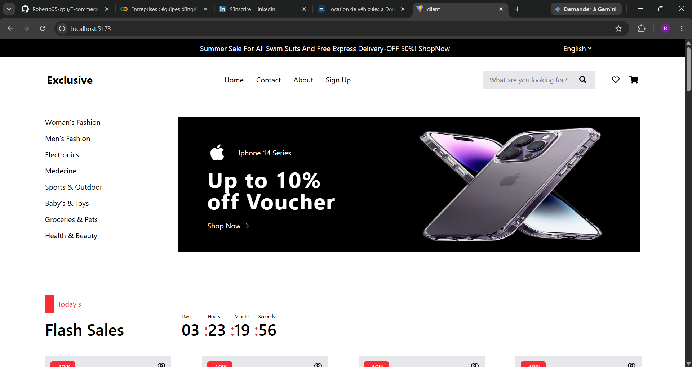

# E-commerce

Application e-commerce construite avec React et Vite côté client, et Node.js, Express et MongoDB côté serveur.



## Fonctionnalités

- Pages d'accueil, de présentation, de contact et catalogue de produits
- Inscription et connexion
- Panier
- API REST pour les utilisateurs, les produits et le panier
- Téléversement et diffusion des images de produits

## Technologies

- **Client :** React, Vite, React Router, Tailwind CSS, Axios
- **Serveur :** Node.js, Express, Mongoose, MongoDB, JWT

## Prérequis

- Node.js et npm
- MongoDB (local ou accessible via une URI)

## Installation et lancement

### 1. Serveur

Depuis la racine du projet :

```bash
cd serveur
npm install
```

Créez un fichier `serveur/.env` avec les variables suivantes :

```env
PORT=3000
MONGO_URL=mongodb://127.0.0.1:27017/ecommerce
JWT_SECRET=remplacez_par_une_cle_secrete_longue_et_aleatoire
```

Adaptez `MONGO_URL` à votre instance MongoDB et définissez une valeur secrète propre à votre environnement pour `JWT_SECRET`. Lancez ensuite l'API :

```bash
node index.js
```

L'API écoute sur le port défini par `PORT` et utilise les routes `/user`, `/product` et `/cart`.

### 2. Client

Dans un autre terminal, depuis la racine du projet :

```bash
cd client
npm install
npm run dev
```

Ouvrez l'adresse locale affichée par Vite. Le client utilise actuellement l'API à `http://localhost:3000`.

### Vérifications du client

Depuis `client/` :

```bash
npm run lint
npm run build
```

## Structure du projet

```text
client/       Application React et configuration Vite
serveur/      API Express, modèles MongoDB et fichiers téléversés
```

## Capture d'écran

Ajoutez la capture d'écran du projet dans `screenshots/capture.png` (créez le dossier `screenshots/` si nécessaire). Elle apparaîtra ici :
